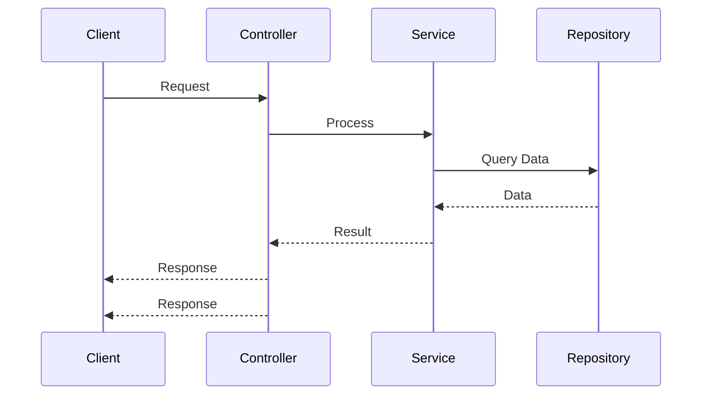
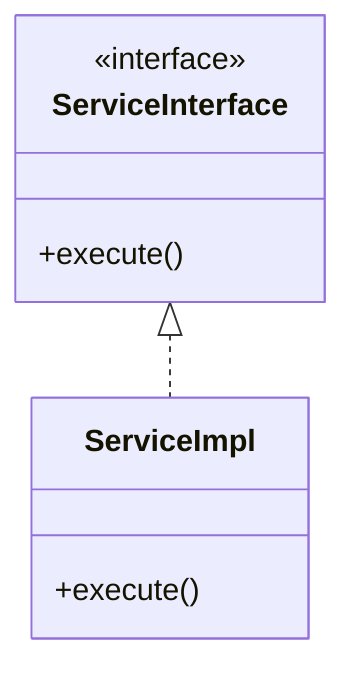

# 🏗️ [Module/Feature Name] Architecture Specification

## 0. Module Information
<!-- Example: Payroll Calculation Engine -->
- **Module Name**: [Module Name]
<!-- Example: py-payroll-operation -->
- **Module Path**: [Module Path]
- **Project Type**: `[Monorepo / Split-Backend / Split-Frontend]`
- **Backend Repository**: `[Git URL or Path]`
- **Frontend Repository**: `[Git URL or Path]`
- **Document Maintainer**: [Architect Name]
- **Last Updated**: YYYY-MM-DD
<!-- Example: v1.2 -->
- **Current Version**: [Version]

---

## 1. Design Vision
*Briefly describe the role of this module/feature in the system, its core responsibilities, and the business problems it solves.*
<!-- Example: This module is responsible for the core payroll calculation logic, including tax calculation, labor and health insurance deductions, and bonus distribution rules. It provides a unified calculation interface for upstream applications and ensures the calculation process complies with country-specific regulations. -->

---

## 2. System Architecture

### 2.1 Module Boundaries and Dependencies
*Describe the relationship between this module and other system components.*
<!-- Example: API Gateway, Scheduling System -->
- **Upstream**: [Upstream Systems]
<!-- Example: Database, External Tax API -->
- **Downstream**: [Downstream Systems]
<!-- Example: common-exception, py-base -->
- **Internal Dependencies**: [Internal Dependencies]

### 2.2 Core Interaction Diagram
*Use a Mermaid sequence diagram to describe the standard execution flow of the core system process.*

---

## 3. Interface Contracts
*This section only lists the interface group index. For detailed specifications, refer to the definition files in the `contracts/` directory. The content may include HTTP APIs, RabbitMQ/Kafka messages, webhooks, or other external integration contracts.*

| Interface Group | Type | Description | Contract Document Link | Base Path / Exchange / Topic |
| :--- | :--- | :--- | :--- | :--- |
| **Payroll Calculation API** | HTTP | Start and query payroll calculation jobs | [contracts/04-calculations-api.md](contracts/04-calculations-api.md) | `/api/v1/payroll-calculations` |
| **Payroll Result API** | HTTP | Query employee payslips and reports | [contracts/06-results-api.md](contracts/06-results-api.md) | `/api/v1/payroll-results` |
| **Master Data Management API** | HTTP | Manage payroll items and rules | [contracts/api-master.md](contracts/api-master.md) | `/api/v1/payroll-masters` |
| **Payroll Calculation Start Message** | RabbitMQ | Send payroll calculation jobs to the background processing queue | [contracts/rabbitmq-payroll-calc-start.md](contracts/rabbitmq-payroll-calc-start.md) | `py.payroll.exchange / calculation.start` |

---

## 4. Data Models
*This section only lists the data model index. For detailed schemas and ER diagrams, refer to `data-model*.md`.*

| Model Name | Description | Document Link |
| :--- | :--- | :--- |
| **Core Transaction Model** | Includes calculation results and execution records | [data-model.md](data-model.md) |
| **Base Configuration Model** | Includes payroll item definitions and tax tables | [data-model-config.md](data-model-config.md) |

---

## 5. Frontend Architecture
*If this module includes frontend components, describe their structure here.*
*(If the project type is Split-Backend, this section should remain but does not need detailed content, or it may only provide the frontend repository link.)*

### 5.1 Page Structure
- **Route**: `/path/to/page`
- **Components**:
    - `MainContainer`: Responsible for layout and state initialization
    - `SubComponent`: Responsible for specific business presentation

### 5.2 State Management
*Describe the design of the global state store and the direction of data flow.*

---

## 6. Backend Architecture
*(If the project type is Split-Frontend, this section should remain but does not need detailed content, or it may only provide the backend repository link.)*

### 6.1 Class Design
*Describe the core classes, interfaces, and their relationships.*

### 6.2 Key Logic and Algorithms
*Explain the complex business logic, state machines, or formulas inside the module in detail.*

---

## 7. Security and Standards
<!-- Example: Requires the `ADMIN` role -->
- **Access Control**: [Access Control Rules]
<!-- Example: All amount fields must be greater than 0 -->
- **Data Validation**: [Validation Rules]
<!-- Example: Sensitive personal data must be masked -->
- **Logging Standards**: [Logging Rules]

---

## 8. Revision History
*Record major architecture-level changes.*

| Date | Version | Source Feature / Context | Summary of Changes |
| :--- | :--- | :--- | :--- |
| YYYY-MM-DD | v1.0 | feature/init-project | Initial architecture definition |
| YYYY-MM-DD | v1.1 | feature/add-tax-calc | Added tax calculation logic and related interface contracts |
